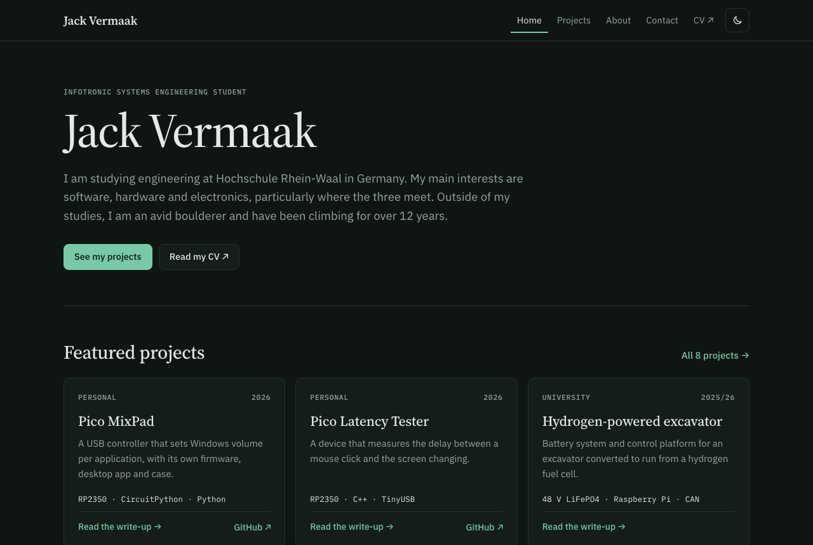

# jackvermaak.com

[](https://github.com/JackVermaak/jackvermaak.com/actions/workflows/links.yml)

My personal website, live at [jackvermaak.com](https://jackvermaak.com).

[](https://jackvermaak.com)

I am Jack Vermaak, an Infotronic Systems Engineering student at Hochschule Rhein-Waal in Germany. The site presents my projects, background and experience, and contact details. It also hosts a copy of the [O-Grader](https://jackvermaak.com/ograder/). `python3 tools/sync_ograder.py ../ograder` copies its pages over unchanged from the [ograder](https://github.com/JackVermaak/ograder) repository; they fetch new ascents from the Worker on jackingtothemax.com.

The site is plain HTML, CSS and JavaScript, hosted on Cloudflare Pages. The pages are generated by `tools/gen.py` (run `python3 tools/gen.py` after editing it), and every push to `main` updates the live site.

## What gets generated

`python3 tools/gen.py` writes every HTML page in `site/`, plus:

| File | What it does |
| --- | --- |
| `site/404.html` | The "page not found" page. Cloudflare Pages serves it, with a 404 status, for any address that has no file. |
| `site/sitemap.xml` | Every indexed page, for search engines. The O-Grader copy is left out, since its canonical address is on jackingtothemax.com. |
| `site/robots.txt` | Allows crawling and points to the sitemap. |

Each page also gets a canonical URL and Open Graph tags, so links shared on LinkedIn, WhatsApp and the like show a preview card with `site/og.png`.

## Link-preview image

`site/og.png` (1200 × 630) is rendered from `tools/og.html` with headless Chrome:

```sh
"/Applications/Google Chrome.app/Contents/MacOS/Google Chrome" --headless=new --hide-scrollbars \
  --allow-file-access-from-files --window-size=1200,630 --screenshot=site/og.png "file://$PWD/tools/og.html"
```

## Checks

`.github/workflows/links.yml` runs on every push, every pull request and every Monday:

- **Pages up to date:** reruns `tools/gen.py` and fails if `site/` changes, so the HTML never drifts from the generator.
- **Internal links:** `python3 tools/check_links.py` checks that every link, image, script and `#anchor` in `site/` resolves the way Cloudflare Pages serves it (`/about` → `about.html`).
- **External links:** [lychee](https://github.com/lycheeverse/lychee) requests every outside link. LinkedIn and Instagram block automated requests, so they are skipped.
